<div align="center">


# Hashtream

### Give your AI trader a little money, not your entire wallet.

Hashtream streams USDT to your AI trading agent every second, on [HashKey Chain](https://hsk.xyz).
It can only spend what it has received. Stop the stream anytime. You're always in control.

[](https://hashkey.blockscout.com/address/0x51f10B56585d45396ff277280B47640B2247E5a8)
[](https://hashkey.blockscout.com/tx/0x210b92ffbc1daa31117ee06414285ef9e4d5631f57cd55dd902fa9634ca535f9)


Built for the **HSK Chain Horizon Hackathon, Mumbai** · Track 1: **AI Agent Trading**

<br />

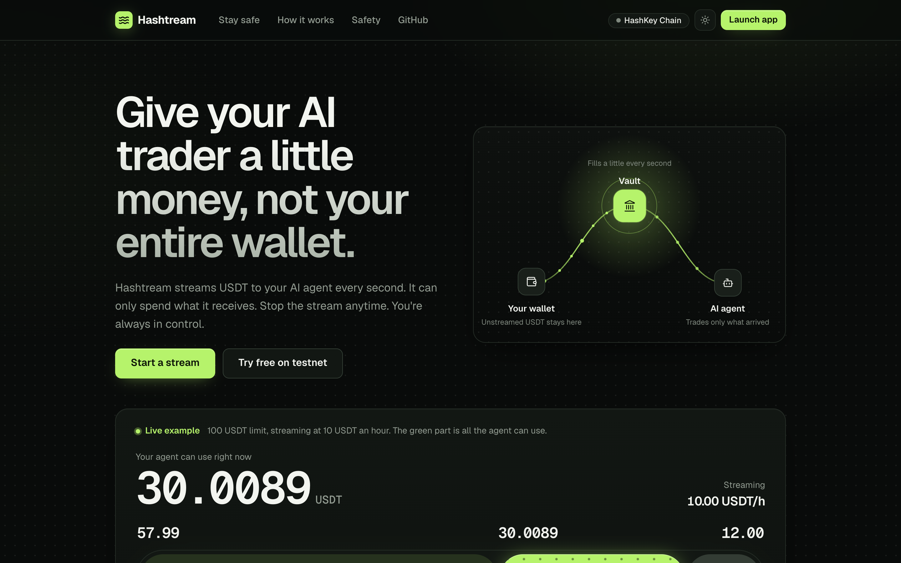

</div>

---

## Contents

- [The problem](#the-problem)
- [The idea](#the-idea)
- [Live on mainnet](#live-on-mainnet)
- [Product tour](#product-tour)
- [How it works under the hood](#how-it-works-under-the-hood)
- [Safety rules the contract enforces](#safety-rules-the-contract-enforces)
- [Repository](#repository)
- [Deployments](#deployments)
- [Run it locally](#run-it-locally)
- [Tests](#tests)
- [Honest notes and limits](#honest-notes-and-limits)
- [Roadmap](#roadmap)

---

## The problem

Every AI trading bot asks for the same thing: **deposit your money into its vault and trust it.**
Risk limits help, but from the first second your whole deposit sits with a model you can't audit, running a strategy
you can't see, on a venue that might be manipulated. If the model makes a bad call, or gets something wrong in a loop, it
has everything.

## The idea

Don't hand the agent a deposit. **Stream it a little money, by the second.**

Your USDT stays in your own wallet. The Hashtream vault pulls a tiny amount each second (the rate you chose, up to the
limit you chose), and the agent can only trade what has already arrived. Everything else is still yours, untouched.

| | Typical AI vault bot | Hashtream |
|---|---|---|
| Money the agent holds on day one | Your whole deposit | Only what has streamed in so far |
| Where the rest of your money is | In the bot's vault | **In your own wallet** |
| How much the agent can ever reach | Deposit × drawdown limit | `rate × time`, capped by your limit, visible live |
| Stopping it | Withdraw and hope it isn't mid-trade | Pause, cancel (everything comes back in one transaction), or revoke the USDT allowance from any wallet |
| Can the agent withdraw? | Depends on the vault | **Never.** It can only swap inside the vault, between allowed tokens |

<br />

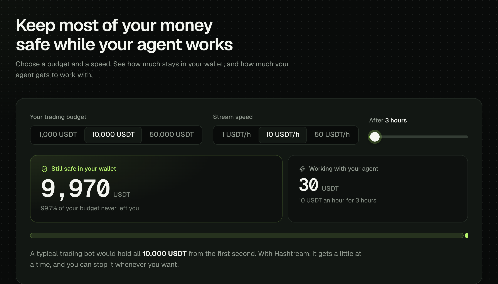

<sub>The home page calculator. Pick a budget, a stream speed and a time. After 3 hours at 10 USDT an hour, 9,970 of
10,000 USDT has never left your wallet.</sub>

---

## Live on mainnet

Hashtream is deployed on **HashKey Chain mainnet (chain 177)** and has made a real trade with streamed capital.

| | |
|---|---|
| **StreamVault** | [`0x51f10B56585d45396ff277280B47640B2247E5a8`](https://hashkey.blockscout.com/address/0x51f10B56585d45396ff277280B47640B2247E5a8) |
| **UniV3Venue** (HSKSwap adapter) | [`0x610070Ee46461FEd78FD4be520D894Ef07866a56`](https://hashkey.blockscout.com/address/0x610070Ee46461FEd78FD4be520D894Ef07866a56) |
| **First agent trade** | [`0x210b92ff…`](https://hashkey.blockscout.com/tx/0x210b92ffbc1daa31117ee06414285ef9e4d5631f57cd55dd902fa9634ca535f9): 0.05 USDT → 0.0000223 WETH on HSKSwap, from stream #2 |
| **Vault deploy** | [`0x72632c2e…`](https://hashkey.blockscout.com/tx/0x72632c2ed6bc26fc95636115c34b40ccc05e46eaa051093b366649e7023af756) |

The first trade's `reasonHash` (the hash of the agent's full decision) is part of the trade transaction itself, so the
reasoning behind it is tied to it permanently on-chain.

---

## Product tour

### 1. A stream you can see

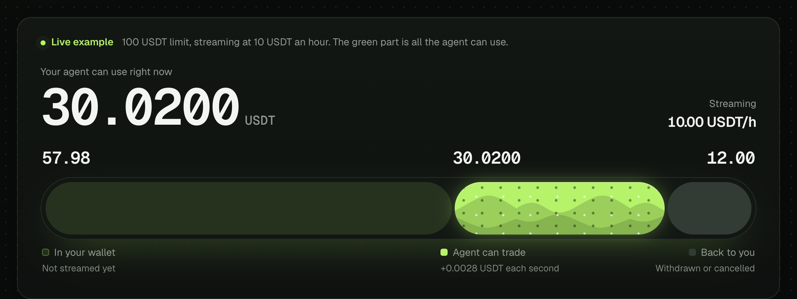

The stream meter is the heart of the product. It ticks every second and splits your money into three parts:

- **In your wallet**: not streamed yet. The agent can't reach it.
- **Agent can trade** (the flowing green part): what has arrived in the vault. This is the most the agent can ever touch.
- **Back to you**: withdrawn or returned on cancel.

### 2. Four plain steps

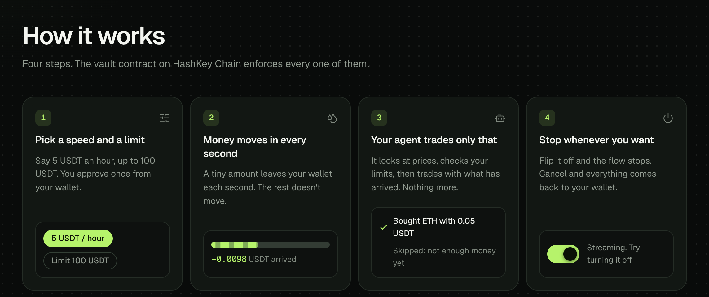

Each step card has a small working visual. The switch in step 4 really stops the flow in step 2, the same way pausing
a stream stops the vault from pulling more.

### 3. Three checks before every trade

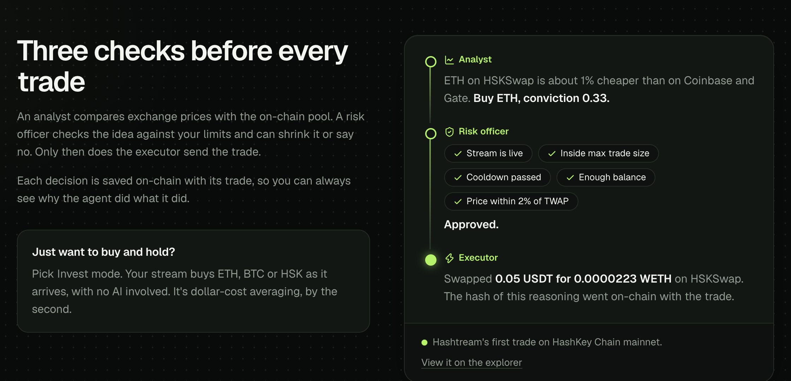

Every trade goes through three roles. The card above is the **actual first mainnet trade**, as the agent logged it:

1. **Analyst** reads Coinbase and Gate prices, the HSKSwap pool price, short-term momentum and the gap between them,
   and forms a view per asset.
2. **Risk officer** checks the idea against your limits (the same limits the contract enforces) and approves, shrinks or
   vetoes it.
3. **Executor** sets the minimum output from the pool's time-weighted price and sends `trade()` with the decision hash.

### 4. Every decision is on the record

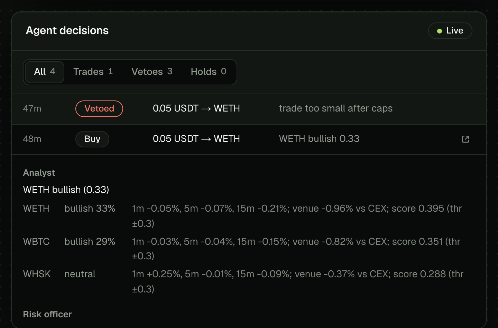

The decision feed shows trades, vetoes and holds. Expand any row to see exactly what the analyst saw and why the risk
officer agreed or said no. Executed trades link straight to the explorer.

### 5. Your stream, under your control

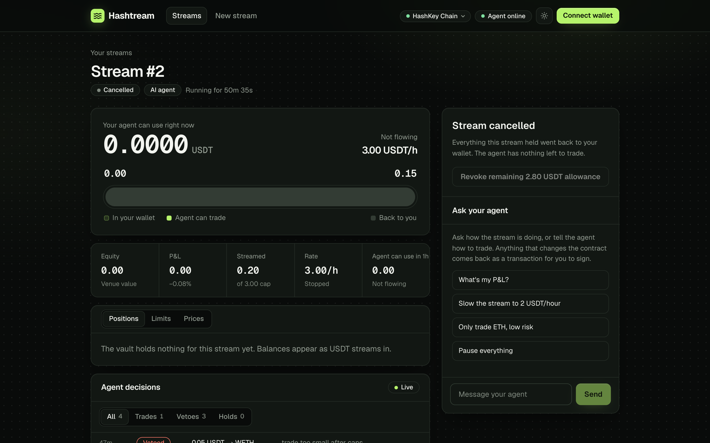

The stream page puts everything in one place: the live meter, equity and P&L, positions, risk limits, prices, the
decision feed and the controls.

- **Hold to kill**: press and hold to cancel. Every token the stream holds comes back to your wallet in one transaction.
- **Pause, resume, set rate, revoke allowance**: all are transactions from your own wallet.
- **Ask your agent**: chat in plain language ("What's my P&L?", "Only trade ETH, low risk", "Slow the stream to
  2 USDT/hour"). Preferences apply right away. Anything that changes the contract comes back as a transaction **you**
  sign, because the agent is never the owner.

### 6. Start a stream in a minute

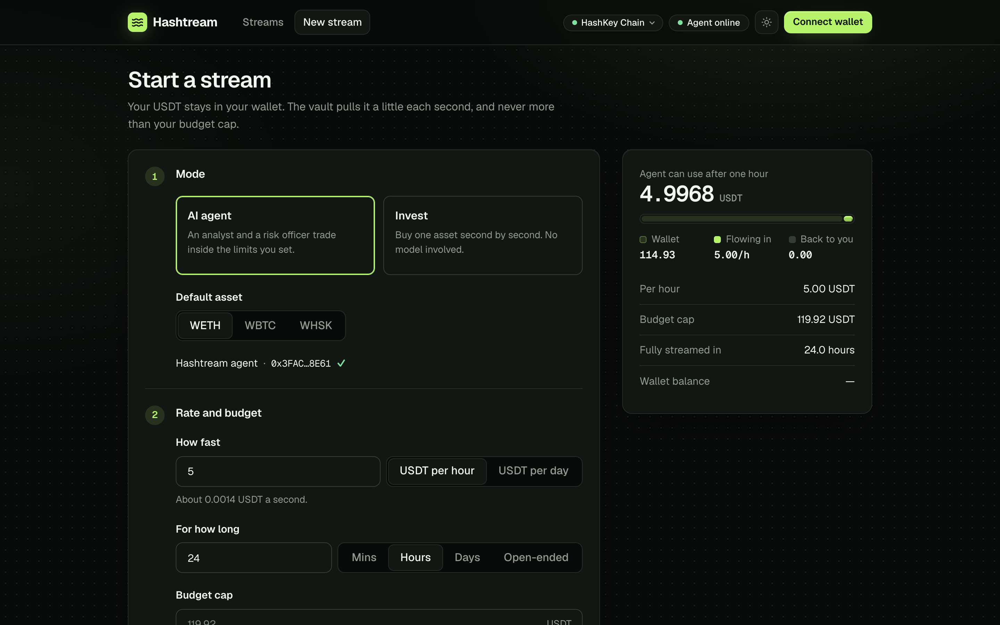

Choose **AI agent** or **Invest** mode, a rate (per hour or per day), a duration (minutes, hours, days or open-ended),
a budget cap and a risk preset. The panel on the right previews what the agent could use after one hour. Then approve
USDT once and create the stream.

**Invest mode** is per-second dollar-cost averaging: the stream buys ETH, BTC or HSK as it arrives, with no AI involved.
Anyone can trigger `invest()`, and every swap is guarded by the same price check.

### 7. Mainnet or testnet, light or dark, desktop or phone

<table>
  <tr>
    <td width="50%">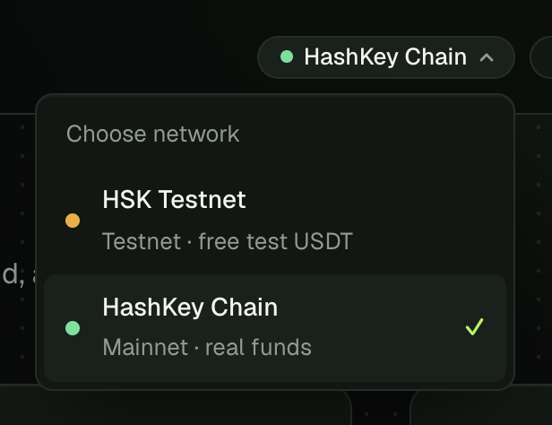</td>
    <td width="50%">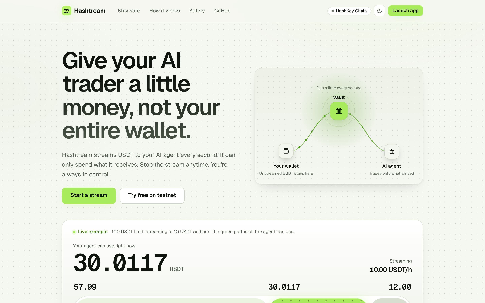</td>
  </tr>
  <tr>
    <td><sub><b>Network switcher.</b> Flip between HashKey Chain mainnet and testnet without reloading. Testnet has a
    faucet for free test USDT.</sub></td>
    <td><sub><b>Light and dark themes.</b> Dark by default, remembered per browser, applied before first paint so it
    never flashes.</sub></td>
  </tr>
</table>

<p align="center">
  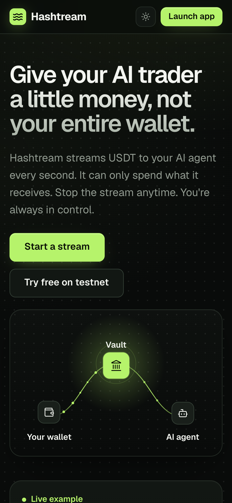
  <br />
  <sub>Fully responsive, down to phone width.</sub>
</p>

---

## How it works under the hood

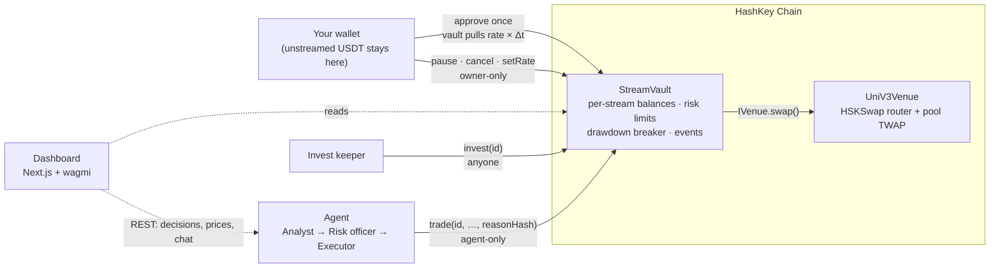

**What happens on one trade**

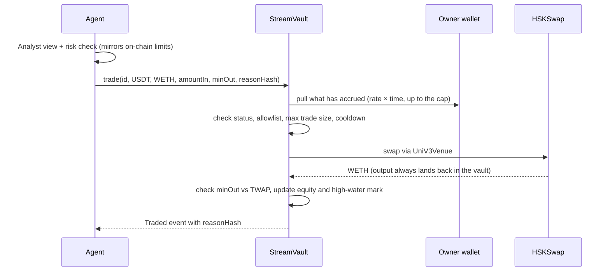

**Key design choices**

- **Streaming is pull-based and lazy.** Nothing moves until someone calls the vault. Each call first accrues
  `ratePerSec × elapsed`, capped by the stream's limit and end time. If your allowance or balance runs short, it pulls
  what it can and never reverts ("starvation-safe").
- **The agent is never the owner.** `trade()` is agent-only and can only swap between allowlisted tokens inside the
  vault. Withdraw, cancel, pause and rate changes are owner-only.
- **Every trade carries its reason.** `reasonHash = keccak256(decision JSON)` is an argument to `trade()` and is emitted
  with the trade.
- **Pluggable venues.** The vault talks to an `IVenue`. Mainnet uses `UniV3Venue` (HSKSwap, a Uniswap v3 fork, with
  60-second TWAP quotes). Testnet uses `MockAMMVenue`, whose prices a keeper syncs to Coinbase and Gate about every 30 seconds,
  because HSKSwap has no testnet deployment.
- **The AI is optional.** With an Anthropic API key, the analyst, risk officer and chat run on Claude. Without one, a
  deterministic rules engine takes over and decisions are labelled `engine: "rules"`.

---

## Safety rules the contract enforces

These live in `StreamVault.sol`, not in a prompt. A trade that breaks one reverts.

| Rule | How it's enforced |
|---|---|
| **Price check** | `minAmountOut ≥ quote × (1 − maxSlippageBps)`, where `quote` is the pool's 60s TWAP (Uniswap v3 `observe`). Protects against manipulated spot prices. |
| **Max trade size** | Each trade's input value is capped at `maxTradeBps` of the stream's equity. |
| **Drawdown breaker** | If equity falls below `highWaterMark × (1 − maxDrawdownBps)`, the stream halts until the owner resumes it. Deposits and withdrawals adjust the high-water mark, so new money can't hide a loss. |
| **Cooldown** | A minimum wait between agent trades stops churn. |
| **Token allowlist** | The agent can only swap between allowed assets (USDT, WETH, WBTC, WHSK), and output always lands back in the vault. |
| **No agent withdrawals** | Only the owner can withdraw or cancel. Cancel returns every token the stream holds in one transaction. |
| **Starvation-safe streaming** | Short allowance or balance means a partial pull, never a revert. Revoking the allowance stops the flow at the source. |

Risk presets on the New stream page:

| Preset | Max slippage | Max trade | Drawdown breaker | Cooldown |
|---|---|---|---|---|
| Conservative | 0.5% | 10% of equity | 5% | 10 min |
| Balanced | 1% | 25% of equity | 10% | 5 min |
| Aggressive | 2% | 50% of equity | 20% | 1 min |

---

## Repository

| Path | What's inside |
|---|---|
| [`contracts/`](contracts) | Foundry. `StreamVault.sol`, `venues/UniV3Venue.sol` (HSKSwap), `venues/MockAMMVenue.sol`, unit tests and mainnet-fork tests, deploy scripts |
| [`agent/`](agent) | Node + TypeScript runtime: `agents/{analyst,risk,proposer,executor,pipeline}.ts`, Invest keeper, chat, Hono REST API |
| [`dashboard/`](dashboard) | Next.js 15 + wagmi: home page and the `/app` (streams, stream detail, new stream) |
| [`deployments/`](deployments) | Addresses per chain + ABIs, read by the agent and the dashboard |
| [`docs/SPEC.md`](docs/SPEC.md) | Interface spec shared by all three parts |

**Dashboard stack:** Next.js 15, React 19, wagmi + viem, TanStack Query, GSAP (hero flow and scroll reveals),
Motion (menus and number tweens), Lucide icons, Geist and Geist Mono.

**Agent REST API** (`agent/src/api.ts`): `GET /api/health`, `GET /api/prices`, `GET /api/streams`,
`GET /api/streams/:id`, `GET /api/streams/:id/decisions`, `GET /api/streams/:id/prefs`, `POST /api/chat`.

---

## Deployments

### HashKey Chain Mainnet (chain 177)

| Contract | Address |
|---|---|
| StreamVault | [`0x51f10B56585d45396ff277280B47640B2247E5a8`](https://hashkey.blockscout.com/address/0x51f10B56585d45396ff277280B47640B2247E5a8) |
| UniV3Venue (HSKSwap) | [`0x610070Ee46461FEd78FD4be520D894Ef07866a56`](https://hashkey.blockscout.com/address/0x610070Ee46461FEd78FD4be520D894Ef07866a56) |
| USDT | `0xF1B50eD67A9e2CC94Ad3c477779E2d4cBfFf9029` |
| WETH / WBTC / WHSK | `0xefd4bC9afD210517803f293ABABd701CaeeCdfd0` / `0x6119CA49a79f5825C8B345F8d7aC36B272565b14` / `0xB210D2120d57b758EE163cFfb43e73728c471Cf1` |

Trades route through HSKSwap SwapRouter02 `0x2c16f75b95Cf1390c328aB70e2CEE7f4b80bD8F3` and the 0.3% USDT pools
WHSK/USDT `0x4ff5…5dC`, WETH/USDT `0xb92b…C16`, WBTC/USDT `0xd9EA…449A`.

### HashKey Chain Testnet (chain 133)

| Contract | Address |
|---|---|
| StreamVault | [`0xe9F69870DC2299f3Da98Abe4ecD00505fF1BA40d`](https://testnet-explorer.hsk.xyz/address/0xe9F69870DC2299f3Da98Abe4ecD00505fF1BA40d) |
| MockAMMVenue | [`0x9188f021E4FbBd00c018D7C1EEC1120eC91b0Ed5`](https://testnet-explorer.hsk.xyz/address/0x9188f021E4FbBd00c018D7C1EEC1120eC91b0Ed5) |
| USDT (mock, with faucet) | `0x610070Ee46461FEd78FD4be520D894Ef07866a56` |
| WETH / WBTC / WHSK (mock) | `0x51f10B56585d45396ff277280B47640B2247E5a8` / `0x7c0c7A59468d1f86b50da8944bdcA00174b49e60` / `0xfFd234D2f61A41711b025f7e00cAaa1E354433eF` |

Example testnet agent trade: [`0x2f87457a…`](https://testnet-explorer.hsk.xyz/tx/0x2f87457a6ff5e5bbb5f14d9447006ed52a2cede1d7dd3d923e8cc21c7eac12f2) ·
example Invest swap: [`0x6c1838c3…`](https://testnet-explorer.hsk.xyz/tx/0x6c1838c338365eef96a61493e117c21eb3da52a0009947444b5aed8f7089a8bb)

> Some mainnet and testnet addresses are identical. Both were deployed from the same deployer at the same nonces, and
> `CREATE` addresses depend only on deployer and nonce.

---

## Run it locally

Requirements: Node 22+, [Foundry](https://book.getfoundry.sh/).

```bash
git clone --recurse-submodules https://github.com/mdmudassir0143/Streamer.git && cd Streamer
cp .env.example .env            # fill in keys (see Environment below)
```

**Contracts**

```bash
cd contracts
forge test --no-match-path 'test/fork/*'                                    # unit tests, offline
forge test --match-path 'test/fork/*' --fork-url https://mainnet.hsk.xyz    # against real HSKSwap pools
set -a; source ../.env; set +a
forge script script/DeployTestnet.s.sol --rpc-url https://testnet.hsk.xyz --broadcast --slow
forge script script/DeployMainnet.s.sol --rpc-url https://mainnet.hsk.xyz --broadcast --legacy --slow
```

**Agent:** run one process per network.

```bash
cd agent && npm install
npm test && npm run typecheck

# mainnet agent on :8787 (CHAIN_ID=177 in .env)
AGENT_DATA_DIR=data/177 npm start

# testnet agent on :8788
CHAIN_ID=133 RPC_URL=https://testnet.hsk.xyz AGENT_API_PORT=8788 AGENT_DATA_DIR=data/133 npm start
```

**Dashboard**

```bash
cd dashboard && npm install
NEXT_PUBLIC_AGENT_API_177=http://localhost:8787 \
NEXT_PUBLIC_AGENT_API_133=http://localhost:8788 \
npm run dev                     # http://localhost:3000
```

Open `/app?network=testnet` and use **Get test USDT** for free test funds, or `/app?network=mainnet` for real funds.
MetaMask is asked to add or switch to the right network when you connect.

### Environment

| Variable | Used by | Notes |
|---|---|---|
| `CHAIN_ID` | agent | `133` testnet · `177` mainnet · `31337` anvil |
| `RPC_URL`, `MAINNET_RPC_URL` | agent, scripts | |
| `DEPLOYER_KEY` | scripts | deploys contracts; owns the mock venue on testnet |
| `AGENT_KEY` | agent | the agent's trading wallet. Needs a little HSK for gas (about 0.18 HSK per mainnet trade) |
| `ANTHROPIC_API_KEY` | agent | optional. Enables the Claude analyst, risk officer and chat |
| `AGENT_API_PORT` | agent | default `8787` |
| `AGENT_DATA_DIR` | agent | decision log and preferences. Use one folder per network |
| `MIN_TRADE_BASE` | agent | smallest trade worth the gas. Default `0.05` USDT on mainnet, `0.5` elsewhere |
| `INVEST_MIN_BASE` | agent | Invest keeper threshold (default `1` USDT, or every 5 min if anything is pending) |
| `NEXT_PUBLIC_CHAIN_ID` | dashboard | default network on first visit |
| `NEXT_PUBLIC_AGENT_API_133`, `NEXT_PUBLIC_AGENT_API_177` | dashboard | agent URL per network (falls back to `NEXT_PUBLIC_AGENT_API`) |

---

## Tests

| Suite | Count | Covers |
|---|---|---|
| `contracts/test/StreamVault.t.sol` | 30 | accrual math, caps and end time, allowance and balance starvation, pause/resume/cancel/withdraw, agent-only trades, allowlist, cooldown, max trade size, slippage, drawdown halt (and that accrual can't hide it), Invest mode, isolation between streams |
| `contracts/test/fork/UniV3Venue.fork.t.sol` | 4 | on a mainnet fork: TWAP tick math vs `slot0`, quote sanity, a real USDT → WETH swap on HSKSwap, and a full vault run end to end |
| `agent/test` | 24 | risk officer checks that mirror the contract limits (13), `minAmountOut` floor, amount parsing and price-sync encoding (4), chat intents: P&L, pause/resume/cancel, rate, risk appetite, asset filter (7) |

---

## Honest notes and limits

- **No arbitrage edge.** HSKSwap prices track centralized exchanges within about 0.1%, and pools charge 0.3%. Hashtream's
  value is bounded, inspectable risk, not promised returns. The product never projects earnings.
- **USDT, not USDC.** Mainnet liquidity on HashKey Chain is concentrated in three USDT pools (about $1M TVL), and USDC
  there is nearly empty.
- **Gas versus trade size.** A mainnet trade costs about 0.18 HSK in gas, so very small streams mostly produce vetoes
  ("trade too small after caps") until enough has streamed in. This is by design.
- **Chat auth.** Chat and preference endpoints identify the owner by address only. Fine for a demo; wallet-signed auth
  is on the roadmap.
- **Unaudited.** These are hackathon contracts. Use small amounts.

## Roadmap

- Wallet-signed auth for agent preferences and chat
- Streams funded by HSP reusable mandates (HashKey Settlement Protocol)
- A strategy marketplace: third-party agents plugged into the same `trade()` permission
- More venues as HashKey Chain liquidity grows

## License

MIT
